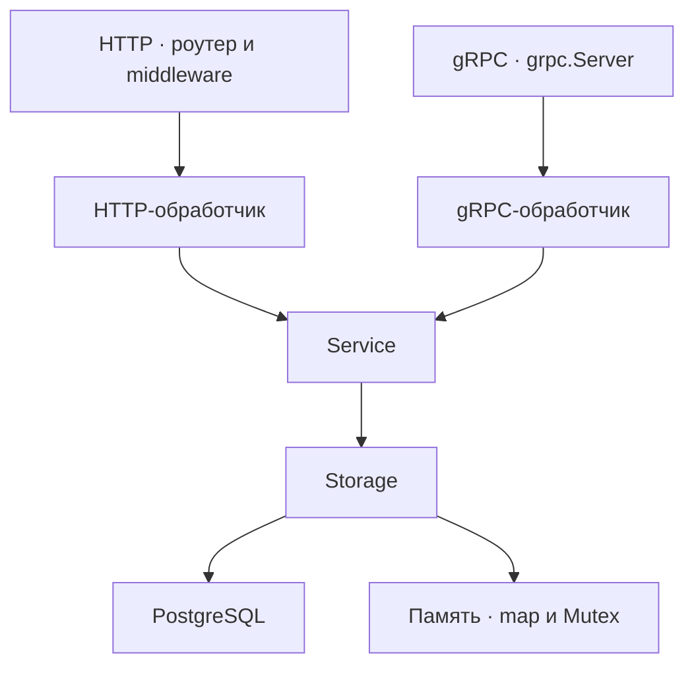

# Архитектура

Сервис состоит из транспорта, service и storage. HTTP и gRPC используют одну бизнес-логику. `TRANSPORT` выбирает один сервер на процесс, `STORAGE` — PostgreSQL или память.

[Запуск и примеры запросов](../README.md)

## Оглавление

- [Слои](#слои)
- [Хранение балансов](#хранение-балансов)
- [История операций](#история-операций)
- [Ошибки](#ошибки)
- [Запуск и остановка](#запуск-и-остановка)
- [Проверки](#проверки)
- [Генерация кода](#генерация-кода)

## Слои



`main` создаёт хранилище, передаёт его в service, затем собирает выбранный сервер.

| Путь | Что находится внутри |
|---|---|
| `cmd/app/main.go` | Конфигурация, создание зависимостей, запуск и остановка |
| `internal/transport` | HTTP-обработчики, роутер `net/http`, логирование метода, пути и длительности |
| `internal/transport/grpcapi` | gRPC-обработчики балансов и истории, преобразование ошибок в статусы gRPC |
| `internal/service` | Валидация операций и параметров истории, интерфейс `Storage` |
| `internal/storage/local` | Балансы в памяти и мьютекс |
| `internal/storage/postgresdb` | SQL, транзакции, обработка ошибок PostgreSQL |
| `internal/domain` | Модель операции и общие ошибки |
| `api/balance/v1`, `gen/go/balance/v1` | Контракт Protobuf и сгенерированный Go-код |

Handler разбирает запрос и вызывает service. Service проверяет параметры и обращается к `Storage`. Проверки текущего состояния счёта выполняет хранилище вместе с изменением баланса — иначе параллельный запрос может изменить данные между проверкой и записью.

`Storage` объявлен в пакете `service`. Чтение и изменение баланса возвращают текущий остаток, а перевод — остатки обоих участников. `ListOperations` возвращает страницу истории. Все методы принимают `context.Context`.

## Хранение балансов

Схема — [migrations/001_init.sql](../migrations/001_init.sql). В `user_balance` две колонки: `user_id BIGINT PRIMARY KEY` с проверкой `> 0` и `balance BIGINT NOT NULL DEFAULT 0` с проверкой `>= 0`. Деньги хранятся в копейках.

В PostgreSQL чтение баланса ищет строку по ID. Начисление создаёт счёт или увеличивает остаток через `INSERT ... ON CONFLICT DO UPDATE`. Списание уменьшает остаток через `UPDATE`, который блокирует строку, а ограничение `CHECK` защищает баланс от ухода в минус.

При переводе `SELECT ... ORDER BY user_id FOR UPDATE` блокирует оба счёта в порядке ID. Это предотвращает взаимоблокировку встречных переводов. Хранилище списывает и зачисляет средства в той же транзакции. При отсутствии получателя или переполнении его баланса списание откатывается.

В `MapStorage` один `sync.Mutex` защищает чтение, проверки и изменения `map[int64]int64`. Данные принадлежат одному процессу и пропадают при его остановке.

## История операций

Таблица `operations` хранит тип, дату, участников, положительную сумму в копейках и комментарий. `recipient_id` заполняется только при переводе. Пропущенный комментарий сохраняется пустой строкой. [Миграция истории](../migrations/002_operations.sql)

При начислении, списании и переводе `PostgresStorage` меняет баланс и вставляет одну запись истории в одной транзакции. Ошибка вставки откатывает изменение баланса.

Обработчики передают размер страницы, сортировку и смещение `(page - 1) * page_size` в `ListOperations`. Хранилище ищет указанный ID в `user_id` или `recipient_id`, поэтому одна строка перевода попадает в историю каждого участника. PostgreSQL сортирует по дате или сумме по убыванию, при равенстве — по убыванию `id`. Затем применяются `LIMIT` и `OFFSET`. Пустая выборка возвращается как успешный ответ.

`MapStorage.ListOperations` возвращает `errors.ErrUnsupported`.

## Ошибки

Storage возвращает ошибки из `domain`, например `ErrNotFound` или `ErrInsufficientFunds`. Для отсутствующих участников перевода есть отдельные ошибки отправителя и получателя. Транспорт выбирает код и публичное сообщение.

| Причина | HTTP | gRPC |
|---|---|---|
| Неверный ID, сумма или перевод самому себе | 400 | `InvalidArgument` |
| Неположительные `page` или `page_size`, неизвестная сортировка | 400 | `InvalidArgument` |
| Пользователь не найден | 404 | `NotFound` |
| Недостаточно средств | 409 | `FailedPrecondition` |
| Переполнение баланса | 409 | `OutOfRange` |
| История запрошена в режиме `memory` | 501 | `Unimplemented` |
| Отмена контекста операции | 500 | `Canceled` |
| Истечение дедлайна операции | 500 | `DeadlineExceeded` |
| Неизвестная ошибка | 500 | `Internal` |

HTTP-handler также отклоняет некорректный JSON и неизвестные поля с кодом 400. Формат его ошибки — `{"error":"сообщение"}`. В gRPC возвращается статус с сообщением и `nil` вместо ответа.

Ошибки PostgreSQL разбираются в storage: `pgx.ErrNoRows` означает отсутствие пользователя, нарушение `balance_non_negative` — нехватку средств, SQLSTATE `22003` — переполнение. Для сравнения используются `errors.Is`, `errors.As`, код ошибки и имя ограничения, а не текст сообщения базы.

## Запуск и остановка

Compose запускает `app` и PostgreSQL 18. Приложение подключается к `db:5432`, клиент с хоста — к `localhost:8080`. Для доступа к базе с хоста проброшен порт 5433. Данные PostgreSQL лежат в томе `pgdata`, подключённом к `/var/lib/postgresql`.

Перед запуском приложения Compose ждёт healthcheck базы; сам `main` проверяет подключение через `Ping`. При ошибке приложение завершается. Dockerfile собирает бинарник в образе Go, затем копирует его в Alpine.

Контекст запроса приходит из `r.Context()` или аргумента RPC и проходит через service в pgx. Контекст сигнала остановки отделён от него, чтобы дать активным запросам завершиться.

На `SIGINT` и `SIGTERM` сервер начинает остановку:

| Транспорт | Ожидание активных запросов | При превышении 10 секунд |
|---|---|---|
| HTTP | `Shutdown` с отдельным контекстом | `Close`; также вызывается при другой ошибке `Shutdown` |
| gRPC | `GracefulStop` в горутине | `Stop` |

При штатном возврате из `main` закрывается пул PostgreSQL. Десять секунд — лимит ожидания сервера, а не всего процесса.

gRPC работает без TLS и reflection. Авторизация и ключи идемпотентности не реализованы: повторный запрос на начисление или перевод снова выполнит операцию.

## Проверки

Тесты service проверяют валидацию и вызовы `Storage`. HTTP-тесты используют `httptest`. Тесты балансовых RPC вызывают обработчики напрямую, а тесты истории и комментариев проходят через сгенерированный gRPC-клиент и сервер `bufconn`.

Интеграционные тесты PostgreSQL проверяют параллельные списания и переводы, откат при ошибке, сохранение комментариев, сортировку и пагинацию. Подготовка отдельной базы и команды запуска описаны в [README](../README.md#тесты).

## Генерация кода

Сообщения и методы описаны в [balance.proto](../api/balance/v1/balance.proto). После изменения контракта нужно пересоздать Go-файлы. Установка инструментов на macOS:

```bash
brew install protobuf
go install google.golang.org/protobuf/cmd/protoc-gen-go@v1.36.12
go install google.golang.org/grpc/cmd/protoc-gen-go-grpc@v1.6.2
export PATH="$PATH:$(go env GOPATH)/bin"
```

Генерация из корня проекта:

```bash
protoc \
  --go_out=. --go_opt=module=github.com/irishout/balance-user-api \
  --go-grpc_out=. --go-grpc_opt=module=github.com/irishout/balance-user-api \
  api/balance/v1/balance.proto
```

Использовался `protoc` 36.2. Контракт и файлы из `gen/go/balance/v1` хранятся в Git; сгенерированный код вручную не меняется. Docker собирает готовые Go-файлы, без запуска `protoc`.
